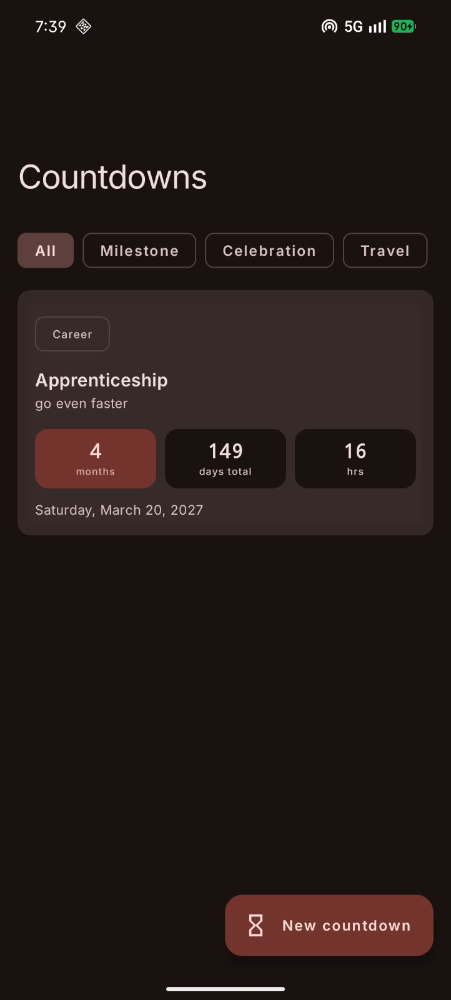
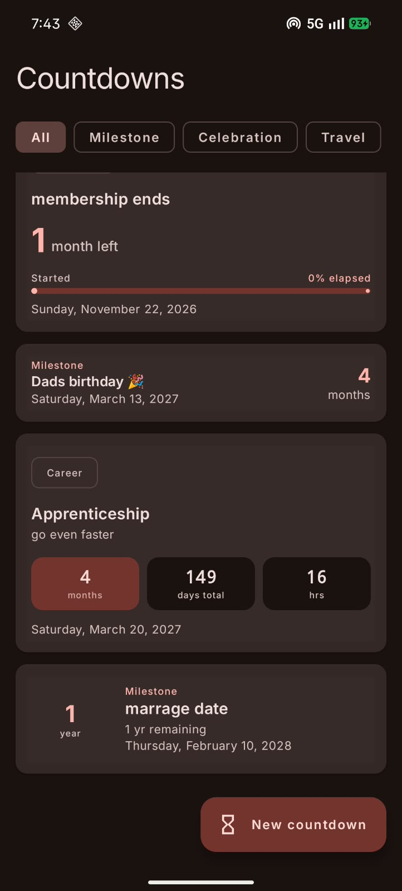
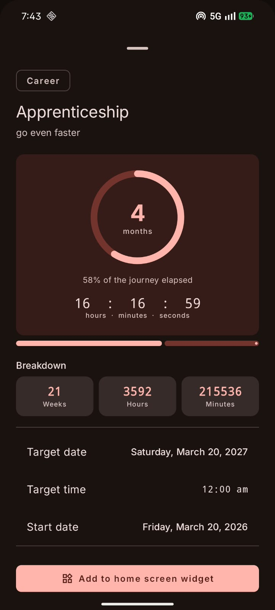

# ⏳ CountDown — Elegant Event Countdown App

[](https://github.com/Dhanushpthampi/CountDownApp/releases/latest)
[-388E3C?style=for-the-badge&logo=android&logoColor=white)](https://github.com/Dhanushpthampi/CountDownApp/releases/download/v1.0.0/CountDown-v1.0.0.apk)
[](https://github.com/Dhanushpthampi/CountDownApp)

> Track what matters. Know exactly how far away.

A clean, Material You Android app that counts down to your most important events, milestones, and goals — displayed in **human-readable time** like *"4 months 10 days remaining"* rather than raw day totals.

📥 **[Download Latest APK (v1.0.0)](https://github.com/Dhanushpthampi/CountDownApp/releases/download/v1.0.0/CountDown-v1.0.0.apk)** directly to your Android device. No build required!

---

## 📸 Screenshots

| Home Screen | All Card Styles | Detail View |
|:---:|:---:|:---:|
|  |  |  |
| Category filter chips + countdown cards | Progress bar, compact, standard & circle cards | Progress ring · live clock · breakdown |

---

## ✨ Features at a Glance

| Feature | Description |
|---|---|
| 🗓️ **Readable Countdowns** | Shows *"2 years 3 months 5 days remaining"* instead of raw numbers |
| 🏷️ **8 Categories** | Milestone, Celebration, Travel, Career, Goal, Creative, Astronomy + All |
| 🎨 **4 Card Styles** | Standard, Compact, Progress Bar, Progress Ring |
| 📊 **Progress Tracking** | Optional start date for journey progress rings & bars |
| 🧩 **Home Screen Widget** | Glanceable widget pinnable to your home screen |
| ⚡ **Live Clock** | Real-time HH:MM:SS ticker in countdown details |
| 🗃️ **Persistent Storage** | Countdowns survive restarts (DataStore-backed) |

---

## 📖 How It Displays Time

CountDown uses **calendar-accurate decomposition** — not division by 30 or 365. Every countdown is broken into the most meaningful units:

```
Remaining         → Displayed as
─────────────────────────────────────────────
> 1 year          →  "2 years 3 months 5 days remaining"
1–12 months       →  "4 months 10 days remaining"
7–30 days         →  "18 days remaining"
< 1 day (hours)   →  "6 hours 45 minutes remaining"
< 1 hour          →  "23 minutes 10 seconds remaining"
Past target       →  "Arrived" / "🎉 Milestone reached!"
```

The same logic applies everywhere:
- **Cards** → readable primary text  
- **Detail sheet** → hero text + breakdown sub-label  
- **Home screen widget** → compact short form (`4mo 10d`)  
- **Relative status** (used internally) → `"In 4 months 10 days"`

---

## 🗂️ Project Structure

```
app/src/main/java/com/redgravity/countdown/
│
├── model/
│   ├── CountdownItem.kt            # Core data class + calculateRemaining()
│   ├── CountdownTimeRemaining.kt   # Computed time breakdown + readable strings
│   ├── CountdownCategory.kt        # 8 category enums
│   └── CountdownCardStyle.kt       # 4 display style enums
│
├── data/
│   ├── CountdownRepository.kt      # DataStore persistence
│   ├── SettingsRepository.kt       # App settings (DataStore)
│   └── WidgetBindingManager.kt     # Widget ↔ countdown binding
│
├── ui/
│   ├── screens/
│   │   ├── CountdownHomeScreen.kt  # Main list screen with live clock
│   │   ├── CountdownDetailSheet.kt # Bottom sheet detail view
│   │   ├── EditCountdownSheet.kt   # Create / edit bottom sheet
│   │   └── SettingsScreen.kt       # App settings screen
│   ├── components/
│   │   ├── ArtisticCountdownCard.kt # All 4 card layout variants
│   │   ├── CategoryChipRow.kt       # Horizontal filter chip row
│   │   └── TimeUnitDisplay.kt       # Reusable time unit display
│   └── theme/
│       └── Theme.kt                 # Material You theme
│
├── util/
│   └── TimeUtils.kt                 # Date formatting + relative status
│
├── CountdownWidget.kt               # Glance home screen widget
└── MainActivity.kt                  # Entry point, navigation
```

---

## 🧩 Key Components Explained

### `CountdownTimeRemaining`
The heart of the display logic. After calling `item.calculateRemaining()`, you get:

| Property | Example | Use |
|---|---|---|
| `readableRemaining` | `"4 months 10 days remaining"` | Hero text, card primary text |
| `shortReadable` | `"4mo 10d"` | Widget, compact summaries |
| `shortSummary` | `"4 mo"` | Progress ring inner label |
| `formattedHours/Minutes/Seconds` | `"06"`, `"45"`, `"30"` | Live HH:MM:SS clock |
| `progressRatio` | `0.62f` | Progress bars and rings |

> **Month accuracy:** Uses `Calendar.add(MONTH, n)` — correctly handles months of different lengths (Jan=31d, Feb=28/29d, etc.), unlike the old `days / 30` approximation.

### Card Styles

| Style | Layout | Best For |
|---|---|---|
| **Standard** | Readable text + optional H/M/S boxes | Default, most info |
| **Compact** | Single row: title ↔ short time | Dense lists |
| **Progress Bar** | Readable text + linear bar (optional) | Journey tracking |
| **Progress Ring** | Circle ring + title + readable text | Visual progress |

### Categories

`Milestone` · `Celebration` · `Travel` · `Career` · `Goal` · `Creative` · `Astronomy`

Filter chips on the home screen let you view any single category or **All**.

---

## 🛠️ Tech Stack

| Layer | Technology |
|---|---|
| Language | **Kotlin** |
| UI | **Jetpack Compose** + Material 3 |
| Widget | **Glance API** (Compose-based widgets) |
| Persistence | **DataStore** (Preferences) |
| Architecture | Single-Activity, unidirectional data flow |
| Min SDK | 26 (Android 8.0) |

---

## 🚀 Getting Started

1. **Clone** the repo and open in Android Studio Hedgehog or newer.
2. **Sync** Gradle (it will download dependencies automatically).
3. **Run** on a device or emulator running Android 8.0+.

```bash
git clone <repo-url>
cd CountDown
# Open in Android Studio → Run 'app'
```

> No API keys, no third-party accounts, no internet permission required.

---

## ➕ Creating a Countdown

1. Tap **"New countdown"** (FAB).
2. Enter a **title** (required) and optional **description**.
3. Pick a **category** and **target date & time**.
4. Optionally enable **"Track progress"** and set a start date — this enables progress bars and rings.
5. Choose a **display style** (Standard / Compact / Progress Bar / Progress Ring).
6. Tap **"Create countdown"**.

Use the **quick preset chips** to jump to common targets: +1 Week, +1 Month, +100 Days, +1 Year, or Next New Year.

---

## 🧩 Home Screen Widget

From any countdown's detail sheet:
1. Tap **"Add to home screen widget"**.
2. If supported, Android will prompt you to place it.
3. If not, long-press your home screen → **Widgets** → **Countdown**.

The widget shows the short readable time (`4mo 10d`) and the event title. Tapping it opens the app directly to that countdown's detail.

---

## 🧹 Code Highlights

### Accurate time decomposition (`CountdownItem.kt`)
```kotlin
// Count full years first using Calendar math
val y = (targetCal.year - nowCal.year).toLong()
// Then count full months from that point
while (tempMonth <= targetMillis) { m++; tempMonth.add(MONTH, 1) }
// Remaining days after stripping whole months
calRemDays = (targetMillis - afterMonthsCal) / DAY_MS
```

### Readable string builder (`CountdownTimeRemaining.kt`)
```kotlin
val readableRemaining: String get() {
    // Builds e.g. "4 months 10 days remaining"
    // or "2 years 3 months 5 days remaining"
    // or "6 hours 45 minutes remaining"
}
```

---

## 📄 License

MIT — free to use and modify.
